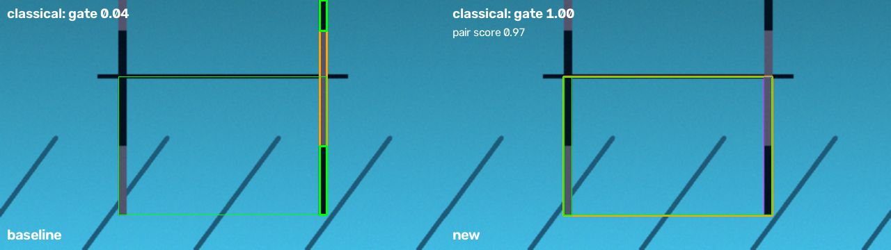
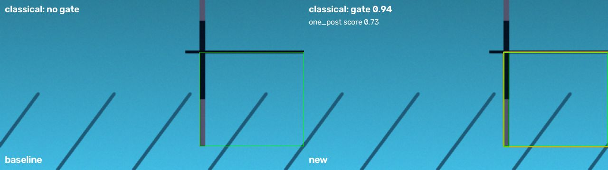
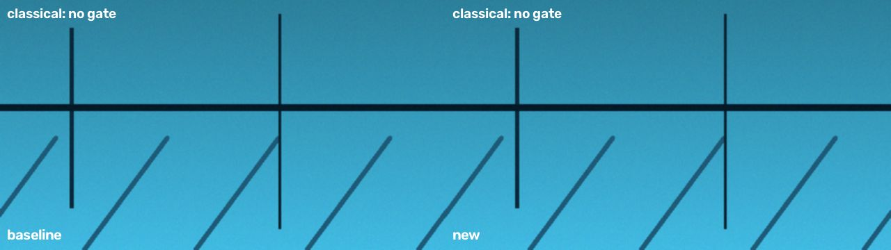

# Perception intro project: classical vs YOLO gate detection

Branch `satyajith/perception-intro`. Two gate detectors that return the same
`GateEstimate` (visible, confidence, center, box): a classical OpenCV pipeline
and a fine-tuned YOLO26-nano, scored on the same held-out test split.

> Step-by-step instructions for finishing and submitting: [docs/STEPS.md](docs/STEPS.md).
>
> **Status:** both detectors are finished and scored on the same 183 held-out
> test images. YOLO: precision 0.98, recall 0.93, mAP50 0.91; classical:
> 0.83 / 0.73 / 0.70; the starting detector: 0.13 / 0.06 / 0.02.

## Setup

```bash
git clone --recurse-submodules https://github.com/berkeleyauv/intro-perception.git
cd intro-perception
git switch satyajith/perception-intro
./scripts/setup.sh            # add --yolo only if you will train/run YOLO locally
source .venv/bin/activate
./scripts/test.sh             # 103 tests
```

## Reproducing the results

The mentor data unpacks to `images/` (1,833 `.jpg`) and `intro_detect/`
(1,833 YOLO labels + `manifest.csv`).

```bash
# Step 1 (CPU, ~1 min): split, dataset counts, baseline + classical on test,
# and output/generated.zip for Colab.
./scripts/full_pipeline.sh /path/to/images /path/to/intro_detect

# Step 2: in Colab run notebooks/train_colab.ipynb with output/generated.zip,
# download yolo_results.zip, then:
./scripts/finish_yolo.sh /path/to/yolo_results.zip
```

Training arguments (local `intro-perception-train` and Colab are identical):
`yolo26n.pt` pretrained, `epochs=30`, `imgsz=640`, `seed=0`,
`deterministic=True`, one class `gate`, data `data/generated/dataset.yaml`.

## Dataset

Auto-labeled and reviewed labels (`manifest.csv`): **1,833 images, 1,480 with
a gate, 353 without, 769 gates cut off by the frame** (almost all at the left
or right edge; their box runs from the visible post to that edge). Images are
640×640.

**The supplied images contain near-duplicates.** They are a Roboflow export of
611 photos × 3 augmented copies (`<photo>_jpg.rf.<hash>`: rotation with gray
borders, hue/brightness/contrast changes), and the photos are video frames
~0.8 s apart from two sessions. With the default per-image split, **179 of the
183 test images had a copy of the same photo in train**, which would inflate
every test score. `intro-perception-data split` now keeps the copies of a
photo together by default, and `--burst-gap 5` (used by the pipeline) also
keeps consecutive frames less than 5 s apart together (59 bursts). Seed 42,
80/10/10 by image count:

| split | images | gate | no-gate | cut-off |
|---|---:|---:|---:|---:|
| train | 1479 | 1184 | 295 | 565 |
| val | 171 | 150 | 21 | 98 |
| test | 183 | 146 | 37 | 106 |

Whole-gate boxes: width/height median 1.35 (p10 1.08, p90 1.53).

Usage of the splits: the classical color table is fitted on **train**, its
thresholds and confidence calibration chosen on **val**, and **test** was run
once at the end. YOLO trains on train, selects its best epoch on val.

## Classical pipeline (`intro_perception/classical.py`, `color_model.py`)

What the real frames look like, and what each stage does about it:

1. **Paint color has no fixed value.** Water tint plus the dataset's hue and
   brightness augmentation move "red" from maroon to mauve to purple. A
   per-pixel **color look-up table** (16³ Lab bins, black/red/background
   log-likelihoods) is applied to each pixel's color *relative to the image
   median and its 41-px surroundings*. It is fitted from the training labels
   only (`scripts/fit_color_model.py`): along the left and right edges of
   each whole-gate box the post is found row by row and a robust line fit,
   giving black and red samples without hand-labeling pixels. This is
   histogram back-projection, not a neural network. Rotation padding (flat
   gray borders) is detected and ignored.
2. **Masks keep vertical structure.** Thresholded log-odds, then a tall
   opening that removes speckle, the crossbar and the diagonal lane lines that
   touch the posts.
3. **Segments** are long, thin, roughly vertical components (tilt ≤ 30° via
   line fits); collinear pieces split by ripples or panels are merged.
4. **Posts from the color pattern.** Black directly above red = left post; red
   above black = right post. Above the crossbar the support pipes continue,
   painted like the *other* post, so the post's top is set one bottom-half
   length above the color change (the halves are equal; on training data the
   color change sits at 0.49 of the box height). Post-like patterns stacked
   directly above a post (supports) are dropped.
5. **Pairing**: left post left of a right post, similar length, aligned tops,
   spacing/height in 0.6–2.6. A mirrored pair (gate seen from behind) scores
   ×0.8.
6. **Cut-off gates**: a lone complete post gives a box from the post to the
   frame edge on the missing post's side (left post → right edge), score ×0.75.
7. **Confidence**: logistic map of the geometric score fitted on val
   (`classical_calibration.json`); below 0.45 the answer is "no gate".

Debug output (`intro-perception-vis`): annotated frame with left (green) and
right (magenta) post boxes plus the candidate type, and the red/black mask
overlay. Sliders: `black_min`, `red_min`.

What changed the validation numbers most (precision / recall / mAP50):
first version tuned on synthetic scenes 0.26 / 0.04 / 0.03 → color table
0.50 / 0.39 / 0.28 → vertical-structure masks 0.77 / 0.63 / 0.60 → color
relative to the 41-px surroundings 0.78 / 0.79 / 0.75 → no-gate cut-off 0.45
chosen on val **0.84 / 0.79 / 0.75**.

### Baseline failures (Milestone 0)

On the test split the starting detector found 9 of 146 gates (precision
0.13, recall 0.06, mAP50 0.02). Its three main failures:

1. **Red is never found.** Its red band is HSV hue 0–10 with V ≥ 100; under
   the pool water the red paint is a muted, blue-dominant mauve (median BGR ≈
   109, 84, 84), nowhere near that band.
2. **Largest dark blobs win.** With red missing it pairs the two largest tall
   dark shapes: support pipes, lane lines, the far wall, rotation borders.
3. **Cut-off gates are impossible.** It requires two posts, but 52% of the
   gates have one post in view (recall on them: 0.02).

Regression tests pin these down on synthetic pool scenes drawn with the
measured paint and water colors (`tests/test_classical.py`,
`scripts/hard_cases.py`; 12/13 pass, the failing one is the washed-out
limitation below). Before/after on synthetic scenes:





## Results on the held-out test split

<!-- comparison:start -->
| metric | baseline | classical | yolo | yolo_cpu |
|---|---:|---:|---:|---:|
| precision @ IoU 0.5 | 0.125 | 0.835 | 0.978 | 0.978 |
| recall @ IoU 0.5 | 0.062 | 0.726 | 0.932 | 0.932 |
| mAP50 | 0.017 | 0.701 | 0.914 | 0.914 |
| mean center error (normalized) | 0.1006 | 0.0163 | 0.0076 | 0.0076 |
| FPS | 582.1 | 25.3 | 83.5 | 8.3 |
| recall, whole gates | 0.175 | 0.750 | 0.875 | 0.875 |
| recall, cut-off gates | 0.019 | 0.717 | 0.953 | 0.953 |
| precision, cut-off gates | 0.047 | 0.844 | 0.990 | 0.990 |
| test frames | 183 | 183 | 183 | 183 |
<!-- comparison:end -->

The `yolo` and `yolo_cpu` columns are the same model and the same answers;
only the timing differs. FPS is single-image latency on the machine that ran
each method: baseline and classical on a 2-core cloud CPU, `yolo` on Colab's
T4 GPU, `yolo_cpu` on Colab's CPU (also 2 cores). Compare speed between
`classical` and `yolo_cpu`.

Annotated test images: `output/annotated/` (classical), `output/side_by_side/`
(classical | YOLO, label in green, prediction in orange), mistakes in
`output/failures/<method>/`.

### Classical failure analysis (41 mistakes in 183 test frames)

Every mistake was looked at (`output/failures/classical/`):

| failure mode | count | what happens |
|---|---:|---|
| Faint, washed-out or distant posts | 15 | low-contrast or bright augmented frames and far gates: the paint is not separated from the water, the post is missed |
| Support pipe read as a post | 11 | a left post's support (red over black, above the crossbar) looks exactly like a right post when the real post's red half is too faint; the box goes above the crossbar toward the wrong edge |
| Box extent wrong | 8 | a post runs off the frame bottom, or one post of a whole gate is missed and the box runs to an edge |
| Strong camera roll (>30°) | 6 | posts are too tilted for the near-vertical assumption |
| Label disagreement | 1 | a reviewer marked "no gate" while a post is visible at the edge |

Examples (left: baseline, right: classical; green = label, orange =
prediction) are in `output/report_images/`: `success_whole_gate.jpg`,
`success_cut_off_gate.jpg`, `failure_support_pipe.jpg`,
`failure_faint_post.jpg`, `failure_camera_roll.jpg`. Add them to the PR
description (they are dataset images, so they are not committed).

Where the classical assumptions break: it assumes both colors of a post are
visible and separable from the water, that posts are near-vertical, and that a
lone post means the gate continues past the frame edge. Cut-off gates work
well when the visible post is clear (recall 0.72, precision 0.84) because the
one-post rule matches how they are labeled; they fail when the visible post is
faint or is confused with its own support pipe.

## YOLO

Trained in Google Colab (`notebooks/train_colab.ipynb`) on a T4 GPU with the
required settings: pretrained `yolo26n.pt`, one class `gate`, 30 epochs,
640 px, seed 0. Training took **14.4 minutes** (864 s for 30 epochs,
`results.csv`). On the validation split the last epoch reached mAP50 0.899
(mAP50-95 0.864); the saved `best.pt` is from epoch 28 (precision 0.914,
recall 0.921, mAP50 0.903, mAP50-95 0.867). Validation mAP50 was already 0.86
at epoch 2 and climbed to about 0.90 over the remaining epochs, with the last
few epochs nearly flat, so 30 epochs was enough.

### YOLO failure analysis (10 mistakes in 183 test frames)

YOLO made 7 misses, 3 boxes with IoU below 0.5 and **no false alarms** on the
37 no-gate images. The 10 frames come from only 6 photos (each photo is in
the data 3 times), and **every one of them is also a classical mistake**:
YOLO fails on a subset of the frames where classical fails.

| failure mode | count | what happens |
|---|---:|---|
| Strong camera roll | 3 | one photo (`1755027671_938639`, 3 copies) taken with the camera rolled about 30–40°: posts and crossbar run diagonally, unlike almost every training image; missed |
| Cut-off gate with only a sliver of post in view | 4 | two photos (`1755027672_330226`, `1755027675_463282`) where the gate runs off the frame and little of the visible post shows, in the same tilted pass as above; missed |
| Label disagrees with the usual box | 3 | `1755028033_048779` and `1755028146_248589` are labeled as a box around a single post, and `1755028144_19422` runs up the support pipe to the top of the frame; YOLO drew the usual crossbar-to-bottom gate box, which looks reasonable but scores IoU 0.01–0.41 |

The pictures are in `output/failures/yolo/` (green = label, orange = YOLO).
Seven of the ten failures are frames from one 4-second stretch of video
(timestamps 1755027671–1755027675), so they are really one hard moment rather
than seven separate problems.

## Discussion

- **Three failure modes (both methods).** (1) Strong camera roll breaks
  both: classical assumes near-vertical posts and YOLO saw few rolled
  examples. (2) Cut-off gates with little of a post visible: classical also
  misses faint posts and confuses posts with their support pipes (11 frames),
  which YOLO does not. (3) Labels that box one post or run up the support
  pipe instead of the usual crossbar-to-bottom box cost both methods the same
  3 frames; the labels should be checked rather than the detectors tuned to
  them.
- **Accuracy vs speed.** YOLO is clearly more accurate: recall 0.93 vs 0.73,
  precision 0.98 vs 0.83, mAP50 0.91 vs 0.70, and half the center error
  (0.008 vs 0.016 of the image). Classical is about **3× faster on a CPU**
  (25.3 vs 8.3 FPS on similar 2-core machines) and needs no training. With a
  GPU YOLO runs at 83.5 FPS, faster than either on a CPU.
- **Training-data coverage.** Train had 619 whole and 565 cut-off gates, so
  both kinds were well covered, and YOLO's recall on cut-off gates (0.95) is
  actually *higher* than on whole gates (0.88). What decides its misses is
  not whole vs cut-off but views that are rare in training: the rolled-camera
  pass causes 7 of its 10 failures. More rolled and tilted views (or stronger
  rotation augmentation) are the most direct way to improve it.
- **Where the classical assumptions fail.** It assumes both paint colors are
  visible and separable from the water, posts are near-vertical, and a lone
  post means the gate continues past the frame edge. It fails on faint or
  washed-out posts (15), support pipes read as posts (11), wrong box extent
  (8) and camera roll (6). On cut-off gates it does well when the visible post
  is clear (recall 0.72, precision 0.84) but YOLO is better there (0.95,
  0.99).
- **What I would deploy and improve next.** YOLO as the gate detector, if the
  robot's computer can run it fast enough (83.5 FPS on a T4 GPU, 8.3 FPS on a
  2-core CPU). Next: add rolled and tilted training images, check the handful
  of inconsistent labels and agree on one rule for where the box top goes
  (crossbar, not support pipe), export the model to ONNX/TensorRT for the
  robot's hardware, and keep the classical color-pattern check running inside
  YOLO's box to tell the left post from the right and estimate the gate's
  orientation, which YOLO's single box does not give.

## Optional extension: orientation

`intro_perception/orientation.py` estimates yaw from a classical post pair:
`cos(yaw) ≈ spacing / head-on spacing` (head-on spacing/height 1.3 from the
labels), sign from the shorter, farther post; mirrored pairs are flagged as
rear views. `scripts/orientation_demo.py` writes a CSV and annotated images
(21 of 183 test frames have a pair; |yaw| median 16°). There are no orientation
labels, so this is checked by eye only; a YOLO box could seed the same post
search inside the box for more pairs.

## Known limitations

- Washed-out frames (contrast halved) and very dark frames lose the paint.
- Support pipes vs posts relies on the red half being visible.
- Camera roll beyond ~30° breaks the near-vertical post assumption.
- The color table and thresholds are fitted to this pool and this
  augmentation; a new pool needs `REFIT=1 ./scripts/full_pipeline.sh ...`.
- A cut-off gate seen from behind is boxed toward the wrong edge, because its
  color pattern points to the opposite side (seen once in the training data).
- YOLO misses gates seen with the camera rolled about 30° or more, which are
  rare in the training data.
- The test split is 183 images but only 61 distinct photos from a few passes,
  so one hard moment (the rolled pass) moves recall by several points.
- A few labels disagree on the box (one post only, or up the support pipe);
  both methods lose those frames.
- YOLO's speed depends on hardware: 83.5 FPS on a T4 GPU but 8.3 FPS on a
  2-core CPU.

## Contributions

- **Satyajith Kesanapally** – everything in this branch: dataset split,
  classical detector, evaluation, YOLO training in Colab, and this report.
- Code and report drafts were written with help from Claude (an AI
  assistant); I ran every step, checked the results, and trained and
  evaluated YOLO myself.
